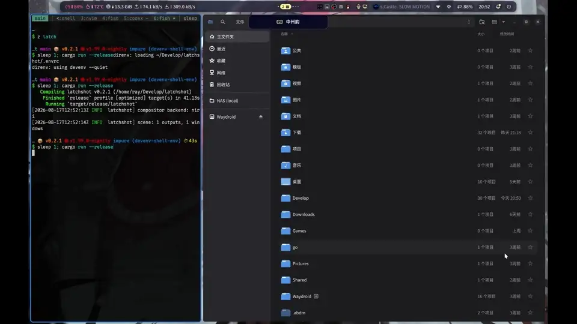

# Latchshot：一个会自动吸附窗口的 Wayland 截图工具

按下就用，用完即走。

## 前言

笔记本换到 NixOS 之后，我一直用 [niri](https://github.com/niri-wm/niri) 当窗口管理器。但用了一圈 Wayland 下的截图工具（包括 niri 自带的），发现它们在「截窗口」「截全屏」和「截自定义区域」的时候，基本都要绑不同的快捷键，或者先弹出一个菜单让你选模式。

我比较习惯微信或者 Snipaste 那种按一个键直接冻结屏幕、鼠标移到哪就自动框住哪个窗口、想截局部就直接按住拖框的交互。既然在 Wayland 下没找到顺手的，就干脆用 Rust 自己写了一个：[Latchshot](https://github.com/so1ve/latchshot)。名字里的「Latch」就是吸附、扣住的意思。



## 交互与用法

启动 Latchshot 后，当前所有屏幕都会被冻结并稍微压暗，不需要提前选模式：

- 移动鼠标会自动高亮指针下面的窗口，点一下左键就截这个窗口；
- 按住左键直接拖动，就会切换成自由选区；
- 按 <kbd>F</kbd> 截取鼠标所在的整块屏幕；
- 按 <kbd>Esc</kbd> 或右键取消。

这样在合成器里只需要绑一个快捷键就够了。

默认情况下截图会通过 `wl-copy` 直接塞进剪贴板，也可以写文件或者输出到 stdout：

```sh
# 默认复制到剪贴板
latchshot

# 保存到文件
latchshot --output ~/Pictures/screenshot.png

# 写到标准输出（也可以和 --clipboard、--output 同时用）
latchshot --stdout > screenshot.png
```

因为支持 `--stdout`，所以很容易直接用管道接给 [Satty](https://github.com/gabm/Satty) 或 [Swappy](https://github.com/jtheoof/swappy) 做标注。比如接 Satty 标注完按回车自动存盘并播一声快门音效：

```sh
file="$HOME/Pictures/latchshot-$(date +'%Y-%m-%d_%H-%M-%S').png"
latchshot --stdout | satty --filename - --output-filename "$file" --actions-on-enter=save-to-file,exit
test -s "$file" && canberra-gtk-play --id=screen-capture
```

另外如果你不喜欢选区框在窗口之间平滑移动的过渡效果，可以加 `--no-animation` 关掉吸附动画；嫌弹窗烦也可以加 `--no-notify` 关掉桌面通知。

## 它是怎么实现的？

在 X11 下，客户端想查桌面上有哪些窗口、各自在什么坐标、再顺手抓张全屏图是很自然的事；但到了 Wayland，安全模型把这些全收紧了。没有任何一个标准 Wayland 协议能同时告诉你「桌面上有哪些窗口」「它们画在哪个坐标」以及「屏幕上有哪些像素」。

所以 Latchshot 启动后其实是把几套接口拼在了一起：

1. **查窗口位置**：连上当前合成器的 IPC socket，读取所有显示器（Output）的逻辑坐标、缩放倍率、旋转方向，以及当前可见窗口的坐标和层叠顺序；
2. **抓冻结画面**：通过 Wayland 的 `ext-image-copy-capture-v1`（或者回退到 `wlr-screencopy-unstable-v1`）把每块屏幕当前的画面抓下来；
3. **铺覆盖层**：用 `wlr-layer-shell-unstable-v1` 和 `wp_viewporter` 在每块屏幕上铺一层全屏 overlay，把刚抓下来的画面贴上去，并在上面画暗色遮罩和选区框；
4. **导出图片**：选中后把逻辑坐标换算回物理像素裁剪出来，或者直接走原生窗口捕获。

因为 overlay 上画的就是启动瞬间抓下来的那一帧，所以就算底下的视频还在播、终端还在滚，你看到和截出来的画面也是完全静止的。

这里最容易踩坑的是 **Wayland 的逻辑坐标和截图物理像素之间的换算**。多显示器各自有不同的缩放比例（包括分数缩放）、旋转方向，甚至两块屏幕之间还可能留有空隙。Latchshot 会分别记录每块屏幕的逻辑矩形和实际抓出来的像素尺寸；如果你按住鼠标跨了两块 DPI 不同的屏幕拉选区，它会按相交屏幕里最高的像素密度来合成最终图片，屏幕之间没内容的空隙则保持透明。在分数缩放下，为了防止浮点数精度误差导致裁出来的图多一列或少一列像素，计算像素边界时还专门做了一层 epsilon 吸附。

### Niri 的窗口坐标与圆角捕获

写 Niri 适配的时候其实走过一段弯路。

最早写 0.1 和 0.2 版本的时候，上游 Niri 的 IPC 只会返回窗口的大小和它在滚动列里的相对序号，并不会直接告诉你这个窗口此刻画在屏幕的哪个坐标上。当时我不仅给 Niri 维护了一个加了 `WindowGeometries` IPC 的自定义分支，甚至在 Latchshot 里写了一千多行的回退代码——拿冻结的桌面截图去扫像素边缘，硬把滚动列在屏幕上的偏移量反推出来 😱

好在后来上游 Niri 合并了 [#4711](https://github.com/niri-wm/niri/pull/4711)，直接在 `WindowLayout` 里暴露了 `tile_pos_in_workspace_view`。有了这个字段之后，直接加上当前输出设备的逻辑原点就能拿到准确的窗口坐标，我也终于在最近把那套自己维护的 Niri 分支和一千行图像边缘反推代码全删干净了。

另一个问题是 **窗口圆角**。如果只是从冻结的全屏画面里按矩形把窗口裁出来，窗口四个圆角外面的背景像素也会被一起截进去。

所以在单击截取单个窗口时，Latchshot 默认不会直接裁全屏图，而是优先走**原生顶层窗口捕获**：

- 如果合成器支持带 `ext-foreign-toplevel-list-v1` 的 `ext-image-copy-capture-v1`，直接通过标准协议抓这个 toplevel（顺手把 Wayland SHM 的预乘 alpha 转回 PNG 用的直通 alpha）；
- 在 Niri 上，则会调用 Niri IPC 的 `ScreenshotWindow` 动作直接让合成器把带透明圆角的窗口渲染出来。

这样截出来的窗口自带合成器原本的透明圆角，不需要像某些工具那样去注入插件或者搞合成器特定的 hack。如果你确实想把窗口背后的壁纸一并裁进来，加个 `--prefer-crop` 参数就会强制从冻结桌面里裁剪。

## 支持的合成器

| 合成器 | 支持情况 |
| --- | --- |
| [niri](https://github.com/niri-wm/niri)、[Sway](https://github.com/swaywm/sway)、[Hyprland](https://github.com/hyprwm/Hyprland)、[Mango](https://github.com/mangowm/mango) | 窗口吸附、自由选区、全屏截图 |
| 其他支持 `wlr-layer-shell` + 截图协议的合成器 | 自动回退到 `generic` 后端，仅支持自由选区与全屏截图 |
| KDE Plasma、GNOME | 不支持（它们走各自的 Portal / Shell 截图流程，不在这套协议栈范围内） |

我自己平时只用 Niri，Sway、Hyprland 和 Mango 的 IPC 适配都是让 GPT 照着接口写的；如果你只用其中一个合成器，自己编译时也可以用 Cargo features（`niri`、`niri-capture`、`sway`、`hyprland`、`mango`）把用不上的后端关掉。

## 安装与配置

有 Rust 工具链的话直接用 Cargo 装：

```sh
cargo install latchshot
```

NixOS 用户可以直接试跑：

```sh
nix run github:so1ve/latchshot
```

如果要写进 NixOS 配置，在 `flake.nix` 里加上 input（可以顺便配上我上篇博客写的 [Firn 二进制缓存](/posts/Linux/NixOS/firn.html) `https://cache.so1ve.dev`，免得在本地重新编译）：

```nix
inputs.latchshot.url = "github:so1ve/latchshot";
```

然后在模块里装上（或者用 `inputs.latchshot.overlays.default`）：

```nix
{ inputs, pkgs, ... }:

{
  environment.systemPackages = [
    inputs.latchshot.packages.${pkgs.stdenv.hostPlatform.system}.default
  ];
}
```

最后在 niri 的 `config.kdl` 里把截图键绑到 `latchshot` 上就行：

```kdl
binds {
    Print { spawn "latchshot"; }
}
```

代码都在 [`so1ve/latchshot`](https://github.com/so1ve/latchshot)，如果你也在用 niri、Sway 或者 Hyprland，不想给截窗口和截区域分别记两套快捷键的话，不妨尝试一下！
